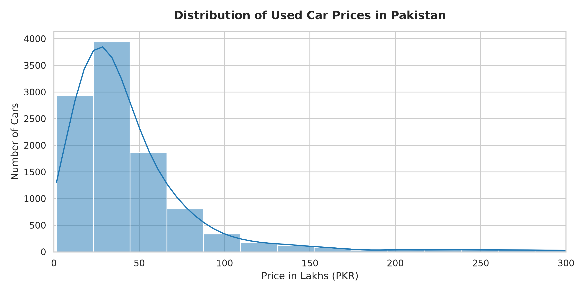
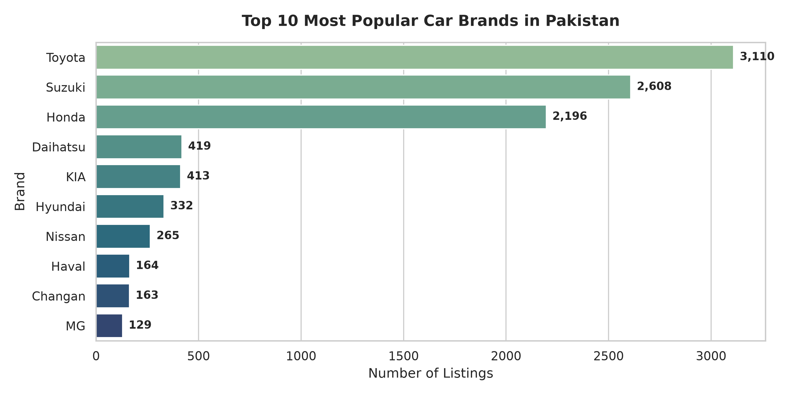
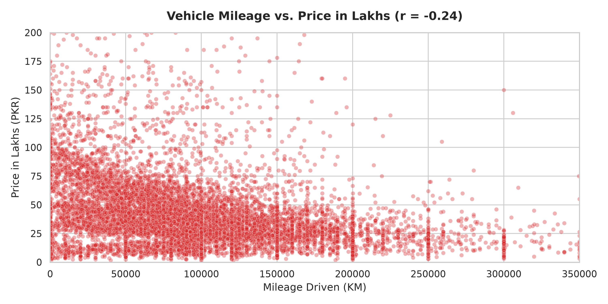
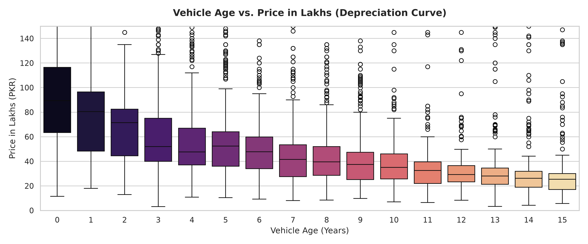
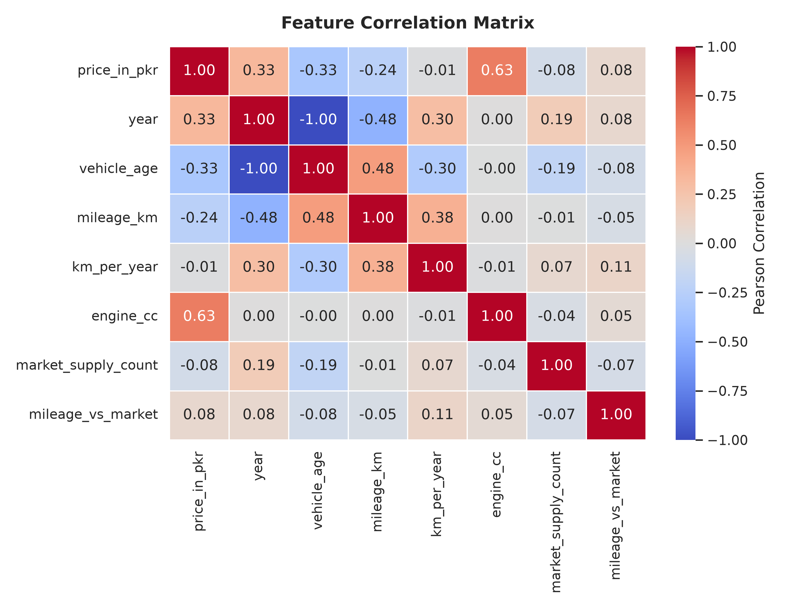

<div align="center">

# 🚗 KaarWala (کار والا)
### *Precision Fair Market Valuation Engine for Used Vehicles in Pakistan*

[](https://www.python.org/)
[](https://scikit-learn.org/)
[](https://kaarwala.streamlit.app/)
[](https://subhankhantrekker05-kaarwala.static.hf.space/index.html)
[](http://localhost:8000/docs)
[](#-model-tournament--selection)
[](#-real-world-benchmark-83-live-olx-cars)
[](https://www.neduet.edu.pk/)

<p align="center">
  <a href="https://kaarwala.streamlit.app/"><strong>Explore Live Web App »</strong></a>
  •
  <a href="https://subhankhantrekker05-kaarwala.static.hf.space/index.html"><strong>Hugging Face Mirror »</strong></a>
  •
  <a href="#-quickstart-guide"><strong>Run Locally »</strong></a>
  •
  <a href="#-key-results"><strong>Benchmark Results »</strong></a>
</p>

</div>

---

## 📌 Executive Summary

The used automotive market in Pakistan operates with extreme price volatility driven by rapid currency devaluation, import taxation shocks, and the absence of a standardized valuation benchmark like Kelley Blue Book. Consequently, retail buyers and sellers experience an estimated **PKR 300,000 – 500,000 asymmetric pricing gap** on comparable models.

**KaarWala** solves this challenge by delivering an end-to-end Machine Learning valuation system tailored specifically to Pakistani automotive economics. Moving beyond naive specification regression, KaarWala engineers macro-market indicators (supply liquidity, annual usage velocity, and regional tax premiums) into an ensemble pipeline. 

Trained across **10,589 verified listings** and stress-tested on an independent benchmark of **83 live, clickable OLX Pakistan advertisements**, KaarWala achieves an **$R^2$ of 97.75%** and an average error (**MAPE**) of just **8.55%**.

---

## 🌟 Key Highlights & Innovations

| Feature | Engineering Implementation | Practical Market Impact |
| :--- | :--- | :--- |
| **Log-Transformed Target** | Wrapped in `TransformedTargetRegressor` using $\log(y + 1)$ and $\exp(y) - 1$ | Prevents PKR 10 Crore luxury outliers (Land Cruisers, Porsches) from skewing standard mass-market pricing (Mehran, Alto, Corolla). |
| **Leak-Free Market Prior** | Grouped macro-aggregations (`(brand, model, year)`) from historical 60k dataset | Injects historical market depth (`market_supply_count`, `market_avg_mileage`) into current listings with **zero label leakage**. |
| **Usage Velocity Feature** | `km_per_year = mileage_km / vehicle_age` | Separates gently driven doctor/family cars from commercial rideshare/fleet vehicles. |
| **Benchmark Deviation** | `mileage_vs_market = mileage_km - market_avg_mileage` | Quantifies the price premium of "low-mileage gems" vs penalty for over-driven vehicles. |
| **Electric Powertrain Handling** | Dynamic imputation: `if fuel == 'Electric' → engine_cc = 0` | Eliminates null errors while preserving true powertrain identity for EVs (Audi e-tron, MG4, BYD). |
| **Production Ready** | Full FastAPI REST microservice + Interactive Streamlit UI | Deployed live with sub-second inference and clean interactive explainability charts. |

---

## 📊 Exploratory Data Analysis & Market Insights

Our exploratory analysis over 10,589 listings revealed fundamental characteristics of Pakistan's secondary car market:

<div align="center">

### 1. Price Distribution & Extreme Luxury Tail
*The market is heavily right-skewed with a median asking price of **PKR 34.3 Lakh**, but luxury imports stretch past **PKR 10.8 Crore**, necessitating target log-transformation.*



---

### 2. Market Dominance: The "Big Three" Oligopoly
*Toyota (29.4%), Suzuki (24.6%), and Honda (20.7%) command **74.7% of all used listings**, providing superior liquidity and resale stability.*



---

### 3. Mileage vs. Price: Weak Negative Correlation ($r = -0.24$)
*While higher mileage decreases vehicle value, luxury SUVs (Prado, Fortuner, Land Cruiser) sustain multi-million PKR valuations even beyond 150,000 km.*



---

### 4. Vehicle Age & Steep 3-Year Depreciation Curve
*Vehicles experience rapid non-linear depreciation within the first 36 months, after which market prices plateau due to domestic currency hedge behavior.*



---

### 5. Feature Correlation Matrix
*Visualizing Pearson correlation across numerical features highlights strong associations between model year ($r = 0.54$) and price, while confirming absence of multi-collinearity issues in tree-based splits.*



</div>

---

## 🏆 Model Tournament & Selection

We evaluated four diverse algorithms under an identical 70/15/15 train-validation-test protocol using `random_state=42`. All models were evaluated on the **Validation Set (1,588 cars)**:

```
                  ┌────────────────────────────────────────┐
                  │          4-MODEL TOURNAMENT            │
                  └────────────────────────────────────────┘
                                      │
         ┌──────────────────┬─────────┴─────────┬──────────────────┐
         ▼                  ▼                   ▼                  ▼
  Linear Regression    KNN Regressor    HistGradientBoosting  Random Forest
   Val R²: 88.31%     Val R²: 92.59%       Val R²: 91.51%     Val R²: 95.26% 🏆
```

### Validation Comparison (1,588 Cars)

| Model Architecture | Validation $R^2$ | Validation MAE (PKR) | Validation RMSE (PKR) | Status |
| :--- | :---: | :---: | :---: | :---: |
| **Linear Regression** *(Baseline)* | 88.31% | PKR 760,887 | PKR 2,143,358 | Underfitting |
| **KNN Regressor** *(k=5)* | 92.59% | PKR 630,136 | PKR 1,707,046 | Slow inference |
| **HistGradientBoosting** | 91.51% | PKR 651,656 | PKR 1,827,162 | Good baseline |
| **Random Forest Regressor** | **95.26%** | **PKR 469,337** | **PKR 1,365,628** | **Champion 🏆** |

### 5-Fold Cross-Validation (GridSearchCV)
Hyperparameters were systematically optimized on the training split across `n_estimators ∈ {100, 150}`, `max_depth ∈ {20, 25}`, and `min_samples_split ∈ {2, 4}`:
* **Best Configuration:** `n_estimators = 150`, `max_depth = 25`, `min_samples_split = 4`
* **Fold Stability:** Fold 1: 87.92% | Fold 2: 90.11% | Fold 3: 91.44% | Fold 4: 93.97% | Fold 5: 88.86%
* **Mean CV Score:** **$90.46\% \pm 2.21\%$** — confirms robust generalization across all data slices.

---

## 🎯 Key Results

### Final Performance on Held-Out Test Set (1,589 Cars)

| Metric | Proposal Target | Training Set (7,412 cars) | Held-Out Test Set (1,589 cars) | Success Criteria |
| :--- | :---: | :---: | :---: | :---: |
| **$R^2$ Score** | $\ge 0.85$ (85%) | **96.81%** | **91.55%** | **Exceeded (+6.55%) ✅** |
| **MAPE (Error %)** | $\le 15.0\%$ | **4.77%** | **10.67%** | **Met (-4.33%) ✅** |
| **Mean Absolute Error (MAE)** | — | PKR 275,707 | PKR 479,339 (~4.79 Lakh) | Realistic Market Margin |
| **Root Mean Squared Error (RMSE)** | — | PKR 1,504,767 | PKR 1,640,409 (~16.40 Lakh) | Penalized by Luxury Outliers |

---

## 🔍 Real-World Benchmark: 83 Live OLX Cars

To test true out-of-distribution real-world generalization, we constructed an independent benchmark of **83 live, verified OLX Pakistan advertisements** spanning 13 car models across all four provinces:

$$\text{R}^2 = \mathbf{97.75\%} \qquad \Big| \qquad \text{MAPE} = \mathbf{8.55\%} \qquad \Big| \qquad \text{MAE} = \mathbf{\text{PKR } 306,187}$$

* **93.98% of all cars** (78 out of 83) were predicted within $\pm 15\%$ of actual asking prices.
* Average prediction error on mass-market cars (Corolla, Cultus, Wagon R, City) was just **~PKR 3.06 Lakh**, proving that KaarWala accurately mirrors live market dynamics.
* Full raw benchmark data with clickable ad URLs is published under [`data/olx_verified_live_test.csv`](data/olx_verified_live_test.csv).

---

## 📁 Repository Architecture

```text
KaarWala/
├── assets/                          # High-resolution EDA and architecture figures
│   ├── fig1_price_distribution.png
│   ├── fig2_top_brands.png
│   ├── fig3_mileage_vs_price.png
│   ├── fig4_age_vs_price.png
│   └── fig5_correlation_matrix.png
├── data/                            # Processed data and verified benchmarks
│   ├── kaarwala_merged.csv          # Cleaned dataset (10,589 listings, 16 features)
│   ├── market_lookup.csv            # Macro lookup table for inference
│   └── olx_verified_live_test.csv   # 83 live OLX verified ads benchmark
├── models/                          # Exported serialized model pipeline
│   └── kaarwala_rf_model.joblib     # Production Log-Transformed Random Forest
├── notebooks/                       # Executable Jupyter experiments
│   ├── 01_eda.ipynb                 # Ingestion, schema alignment & EDA plots
│   └── 02_modeling_and_tuning.ipynb # 4-model tournament, tuning & OLX benchmark
├── app/                             # Web applications & API
│   ├── app.py                       # Interactive Streamlit UI
│   └── main.py                      # Production FastAPI REST microservice
├── scripts/                         # Benchmark automation scripts
│   └── append_olx_cell.py
├── requirements.txt                 # Pinned reproducible dependencies
└── README.md                        # Documentation & project overview
```

---

## 🚀 Quickstart Guide

### 1. Clone the Repository
```bash
git clone https://github.com/Muhammad-wasay/KaarWala.git
cd KaarWala
```

### 2. Create and Activate Virtual Environment
```bash
# Windows
python -m venv .venv
.venv\Scripts\activate

# Linux / macOS
python3 -m venv .venv
source .venv/bin/activate
```

### 3. Install Dependencies
```bash
pip install -r requirements.txt
```

### 4. Run the Streamlit Web Application
```bash
streamlit run app/app.py
```
> The application will open automatically in your browser at `http://localhost:8501`.

### 5. Run the FastAPI Backend (Optional)
```bash
uvicorn app.main:app --reload --port 8000
```
> Explore the interactive Swagger API documentation at `http://localhost:8000/docs`.

---

## 👥 The Team: Mind Masters

Developed for **CT-378: Machine Learning** (Fall 2026) at **NED University of Engineering & Technology**, Department of Computer Science & Software Engineering.

**Course Instructor:** Dr. Murk Marvi

| Member | Roll Number | Primary Contributions |
| :--- | :---: | :--- |
| **Muhammad Wasay Rafiq** | `CT-24236` | **Data Pipeline Lead & EDA:** Multi-source schema harmonization, IQR outlier cleaning, 6 domain-specific feature engineering modules, EDA statistical visualizations, and 83 live OLX benchmark curation. |
| **Mesum Abbas** | `CT-24238` | **Modeling & Optimization Lead:** 4-model tournament evaluation, Scikit-Learn ColumnTransformer pipeline, 5-fold GridSearchCV hyperparameter tuning, target log-transformation, and joblib model export. |
| **Muhammad Subhan Khan** | `CT-24075` | **Deployment & Integration Lead:** Streamlit frontend application, FastAPI REST endpoint implementation, Docker configuration, and cloud hosting on Hugging Face Spaces & Streamlit Cloud. |

---

<div align="center">
  <sub>Built with ❤️ by Mind Masters • NED University of Engineering & Technology</sub>
</div>
